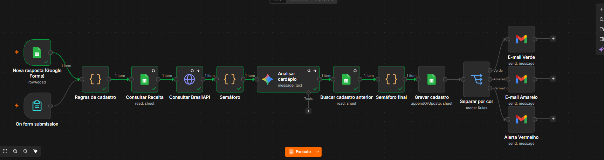
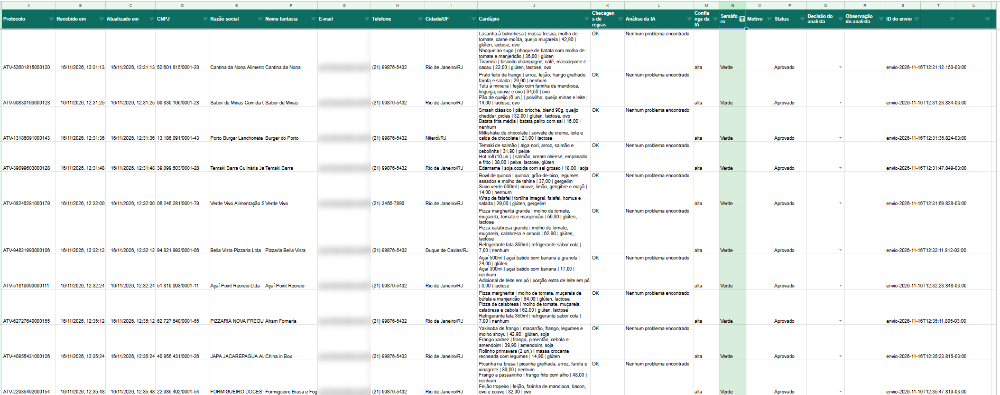
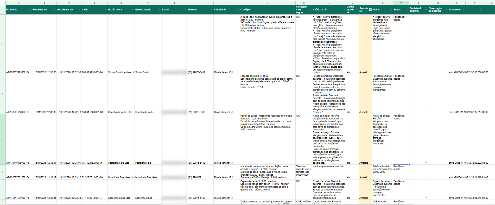
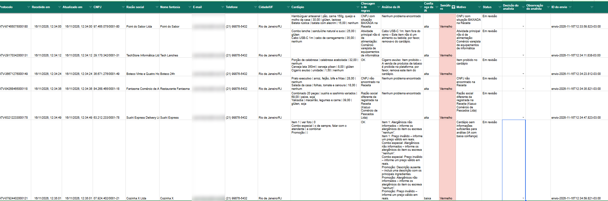

# Ativação de Restaurantes com n8n + IA

Fluxo automatizado que recebe o cadastro de um restaurante, valida dados cadastrais e cardápio, consulta o CNPJ na Receita Federal e decide, por regra, se o cadastro é aprovado, se precisa de ajustes ou se vai para revisão humana. O restaurante e o time de ativação são avisados por e-mail conforme o resultado.

Projeto protótipo, construído por Yasmin Barsottelli como estudo de caso de ativação de parceiros em plataformas de delivery.

> **Status:** fluxo funcional de ponta a ponta, com formulário público, consulta real de CNPJ e IA. Bateria de 25 casos (20 fictícios e 5 restaurantes reais): 25 de 25 com o resultado esperado.

---

## O problema

Na ativação de um restaurante, o time precisa conferir dados cadastrais, a situação do CNPJ, a atividade econômica e a qualidade do cardápio (descrições, preços, alergênicos, itens permitidos). Feito à mão, isso é lento, sujeito a erro e difícil de auditar. Feito só com IA, fica imprevisível e difícil de explicar.

## A solução: validação em camadas

O fluxo separa o que é **regra** do que exige **interpretação**:

| Camada | O que verifica | Como |
|---|---|---|
| 1. Formulário (Google Forms) | Campos obrigatórios, formato de CNPJ, telefone, e-mail, Cidade/UF e da estrutura do cardápio | Validação na origem, com expressões regulares |
| 2. Regras cadastrais | CNPJ (dígitos verificadores), telefone, campos vazios | Código e Regex |
| 3. Receita Federal | Situação cadastral ATIVA, CNAE de alimentação, razão social | BrasilAPI (CNPJs reais) ou base simulada (testes) |
| 4. Cardápio por regra | Descrição vazia, alergênicos em branco, preço inválido, alergênico citado e não declarado | Dicionário de Regex |
| 5. Cardápio por IA | Preço fora da realidade, item proibido, item fora do ramo, legibilidade | Gemini (lista fechada de problemas, saída em JSON) |
| 6. Decisão | Cor do semáforo e status | Regra em código, nunca a IA |

A IA **aponta**; quem **decide** é a regra. Cada Verde, Amarelo ou Vermelho tem um motivo escrito e rastreável na planilha.

## Fluxo

```
Google Forms (restaurante) ─┐
Formulário interno (testes) ┴→ Regras de cadastro → Consultar Receita (base simulada)
  → Consultar BrasilAPI → Semáforo (regras) → Analisar cardápio (IA)
  → Buscar cadastro anterior → Semáforo final → Gravar cadastro (planilha)
  → Separar por cor
       ├─ Verde    → e-mail de aprovação ao restaurante
       ├─ Amarelo  → e-mail ao restaurante com o que ajustar
       └─ Vermelho → alerta ao time de ativação (restaurante não é notificado)
```



Dois gatilhos alimentam o mesmo fluxo. O **Google Forms** é a porta do restaurante, com validação na entrada. O **formulário interno do n8n** é a porta de testes: ele não tem as validações de formato, o que permite testar se a segunda camada (as regras do fluxo) pega sozinha os erros que a primeira barraria.

## Regras de negócio

**Princípio:** avisar, registrar e deixar o restaurante decidir.

- **Pendência obrigatória (Amarelo até corrigir):** dados cadastrais inválidos, descrição vazia, alergênicos em branco, preço zero ou não numérico.
- **Aviso (Amarelo no primeiro envio):** possível alergênico não declarado e preço fora do padrão. Se o restaurante reenviar o mesmo cardápio, o cadastro é aprovado com o registro "restaurante ciente do aviso". A declaração do cardápio é responsabilidade do restaurante, e o fluxo guarda a evidência de que ele foi avisado.
- **Vermelho (revisão humana):** CNPJ não encontrado ou com situação diferente de ATIVA, atividade principal fora de alimentação, razão social divergente, item proibido (ex.: tabaco), item fora do ramo, cardápio ilegível, falha da IA ou da consulta à Receita.
- **Reenvio:** atualiza a mesma linha da planilha (chave: CNPJ), preserva a data do primeiro envio e registra a pendência como resolvida.

## Decisões de design

- **IA com escopo fechado.** O modelo só pode apontar problemas de uma lista fixa de códigos e devolve JSON. Categorias livres tornariam impossível transformar a análise em regra.
- **Alergênicos por Regex, não por IA.** Nos primeiros testes, o modelo presumia ingredientes que não estavam escritos (ex.: "nhoque geralmente leva lácteos"), mesmo com o prompt proibindo. A verificação de alergênicos passou para um dicionário de Regex, determinístico e auditável, com exceções tratadas (ex.: "pão de queijo" não indica glúten; "farinha de mandioca" não é trigo). A IA ficou só com o que exige interpretação.
- **Consulta à Receita em duas camadas.** O CNPJ é procurado primeiro numa base simulada, que controla os cenários de teste (CNPJ baixado, CNAE fora do ramo, razão social divergente). Se não estiver nela, o fluxo consulta a **BrasilAPI**, com dados reais da Receita. A comparação de razão social ignora maiúsculas, pontuação e sufixos societários (LTDA, ME, EPP, EIRELI, S/A). Se a API estiver fora do ar, o cadastro vai para revisão humana em vez de ser tratado como "CNPJ não encontrado".
- **Idempotência no reenvio.** Cada envio tem um identificador (carimbo do Google Forms ou horário do formulário interno). Só conta como reenvio do restaurante um envio com identificador diferente do anterior. Isso foi corrigido depois de um teste: ao reprocessar uma execução que tinha falhado no envio do e-mail, o fluxo interpretou o reprocessamento como "restaurante reenviou o mesmo cardápio" e aprovou com ciência um restaurante que nunca tinha sido avisado.
- **Temperatura 0.** A tarefa é classificação, não criação. Consistência é necessária para medir acurácia.
- **Escolha do modelo por cota e custo.** No plano gratuito da API Gemini, os modelos Flash Lite permitem 500 requisições/dia, contra 20/dia dos Flash maiores, o que inviabilizaria rodar a bateria de testes mais de uma vez. O fluxo usa o Gemini 3.1 Flash Lite; o 3.5 Flash Lite apresentou indisponibilidade por alta demanda no período de testes.
- **Resiliência.** O nó de IA tenta até 5 vezes. Se ainda assim falhar, o cadastro não se perde: segue para revisão humana com o motivo registrado.
- **Privacidade desde o desenho.** Só o cardápio é enviado à IA. CNPJ, e-mail e telefone nunca saem do fluxo.
- **Injeção de prompt.** Um restaurante poderia escrever no cardápio instruções para a IA. O risco é contido porque a IA não decide nada: no pior caso, deixa de apontar um problema, e as camadas de regra continuam valendo.

## Testes e resultados

Bateria de **25 casos**, cada um com resultado esperado definido antes da execução:

- **20 restaurantes fictícios** (7 esperados Verde, 7 Amarelo, 6 Vermelho), cobrindo CNPJ com dígito inválido, baixado e inexistente, CNAE fora do ramo, razão social divergente, telefone inválido, alergênicos não declarados, preços incoerentes, descrições vazias, item proibido, item fora do ramo e cardápio ilegível.
- **5 restaurantes reais do Rio de Janeiro**, com CNPJ consultado na BrasilAPI.

> **Aviso sobre os restaurantes reais:** só o CNPJ e os dados da Receita Federal (razão social, situação cadastral e atividade econômica, obtidos pela BrasilAPI) são reais. **Os cardápios foram inventados para o teste**, e os problemas apontados neles (como alergênico não declarado ou preço fora do padrão) existem apenas nesses cardápios fictícios. Eles não dizem nada sobre os cardápios, os preços ou a operação desses estabelecimentos. Nenhum e-mail foi enviado a eles.

| Nome fantasia | CNPJ | Situação e atividade na Receita (real) | Cardápio de teste (fictício) | Resultado |
|---|---|---|---|---|
| Aham Forneria | 62.727.640/0001-55 | Ativa · Lanchonetes, casas de chá, de sucos e similares | Sem problemas | Verde |
| China in Box | 40.955.431/0001-26 | Ativa · Fornecimento de alimentos para consumo domiciliar | Sem problemas | Verde |
| Boleria Di Norma | 59.950.528/0001-74 | Ativa · Comércio varejista de doces | Alergênico omitido de propósito | Amarelo |
| Formigueiro Brasa e Fogão | 22.985.492/0001-54 | Ativa · Restaurantes e similares | Sem problemas ("farinha de mandioca" como armadilha) | Verde |
| Padaria Flor do Valqueire | 33.562.570/0001-24 | Ativa · Padaria e confeitaria | Preço errado de propósito | Amarelo |

Os e-mails de teste usam endereços do tipo `usuario+restNN@gmail.com`, que chegam a uma única caixa: nenhum e-mail foi enviado a terceiros.

### Resultado da bateria final (16/11/2026)

**25 de 25 casos com a cor esperada.** A tabela mostra o resultado esperado (linhas) contra o obtido (colunas):

| Esperado ↓ / Obtido → | Verde | Amarelo | Vermelho |
|---|---|---|---|
| **Verde (10)** | 10 | 0 | 0 |
| **Amarelo (9)** | 0 | 9 | 0 |
| **Vermelho (6)** | 0 | 0 | 6 |

Além da cor, o motivo registrado bateu com o motivo esperado em todos os casos, incluindo os que tinham mais de um problema (ex.: preço incoerente e três alergênicos não declarados no mesmo item; CNAE de informática e item não alimentício no mesmo cadastro).

**Como ler esse número com honestidade:** a massa de testes é pequena e foi escrita pela mesma pessoa que desenhou as regras, e as regras foram ajustadas ao longo do desenvolvimento. O resultado mostra que as regras fazem o que foram desenhadas para fazer; não é uma estimativa de acurácia em produção. Para isso, seria preciso rodar o fluxo sobre cadastros reais e revisar uma amostra.







*Planilha de resultados do teste (coluna de e-mail ocultada). Nos restaurantes reais, os cardápios e os problemas apontados são fictícios; só os dados da Receita são reais.*

Os 20 casos fictícios, com resultado e motivo esperados, estão em [`casos-de-teste.csv`](casos-de-teste.csv).

### O que os testes mudaram no fluxo

| Achado | Correção |
|---|---|
| A IA presumia ingredientes não escritos (falsos positivos de alergênico na Cantina da Nona e no Point do Sabor) | Alergênicos passaram para um dicionário de Regex; a IA ficou só com preço, item proibido, item fora do ramo e legibilidade |
| "Pão de queijo" e "farinha de mandioca" seriam lidos como glúten | Exceções explícitas no dicionário |
| Reprocessar uma execução com falha aprovava um restaurante que nunca foi avisado | Identificador de envio (idempotência) |
| Razões sociais reais vêm em maiúsculas e com sufixos societários | Comparação normalizada |
| O Google Sheets acrescenta aspas ao copiar células com várias linhas, e o Google Forms grava títulos de pergunta com espaços sobrando | Limpeza das aspas e dos nomes de campo na entrada |
| Um e-mail com formato errado faria o aviso nunca chegar | Validação de e-mail no formulário |

## Limitações conhecidas

- **n8n local.** O fluxo roda em n8n self-hosted (Docker). O Google Forms é público, mas o processamento depende do computador com o n8n ligado; o gatilho confere novas respostas a cada minuto.
- **Massa de testes pequena.** 25 casos validam as regras, mas não substituem uma amostra real de cadastros.
- **Cardápio em texto.** O formato "nome | descrição | preço | alergênicos" é simples de validar, mas não é como restaurantes costumam manter cardápios. Em produção, a entrada seria uma planilha, um arquivo ou uma integração.

## Próximos passos

- Aba de histórico com cada evento do cadastro (trilha de auditoria).
- Parâmetros (CNAEs aceitos, e-mail do time) fora do código.
- Fechar o ciclo do Vermelho: avisar o restaurante quando o analista registrar a decisão na planilha.
- Workflow de erro e resumo diário para o time (pendências abertas e vencidas).
- Hospedar o n8n em nuvem, com credenciais OAuth em modo de produção.

## Stack

n8n (self-hosted, Docker) · Google Forms · Google Sheets (gatilho e base) · Code nodes (JavaScript) · BrasilAPI · Google Gemini API (plano gratuito) · Gmail

## Autoria e uso de IA

Desenho da solução, regras de negócio, escopo da IA, regra do semáforo, validações do formulário, massa de testes e validação: Yasmin Barsottelli.
O JavaScript dos nós Code foi gerado com assistência de IA (Claude) a partir dessas especificações e validado com os casos de teste.

## Como rodar

1. Importe `workflow.json` no n8n (os IDs da planilha e o e-mail do time aparecem como `SEU_ID_DA_PLANILHA` e `time-de-ativacao@exemplo.com`).
2. Crie as credenciais de Google Sheets, Google Sheets Trigger, Gmail e Google Gemini (as credenciais não vão no arquivo).
3. Crie uma planilha com as abas `Cadastros`, `Receita simulada` e `Restaurantes de teste` (use `casos-de-teste.csv`), vincule as respostas de um Google Forms com as perguntas CNPJ, Razão social, Nome fantasia, E-mail, Telefone, Cidade/UF e Cardápio, e aponte os nós de planilha para ela.
4. Publique o workflow e envie um cadastro pelo formulário.
